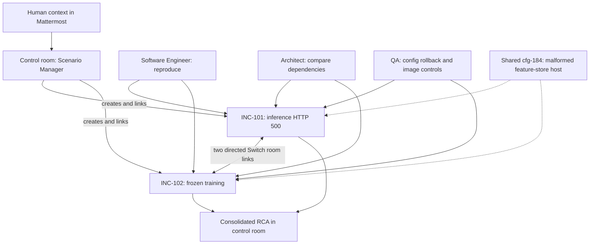

# Switch incident workspace

Investigate two apparently separate ML incidents in linked rooms: inference starts returning HTTP 500 after a deployment, while a recommendation training job stays RUNNING with no progress for six hours. A Scenario Manager coordinates a Software Engineer, Architect and QA specialist, then returns one evidence-backed root cause analysis. People can add context during the investigation.

The common cause in the supplied synthetic fixture is a shared configuration push containing a misspelled feature-store hostname. The inference image deployment is a competing hypothesis. The replay tests both services with the failing configuration, a configuration-only rollback, and an old-image control. This makes the exercise useful for practicing cross-service correlation and distinguishing job liveness from progress.

There are two execution modes:

- **Offline replay** runs deterministic Python simulation with no model, Docker, credentials, network requests or live messaging. Role handoffs are scripted events. It does not impersonate a live AI investigation.
- **Live local Switch workspace** uses the real upstream Docker stack, Mattermost and four provider-backed agents. The supplied templates use Switch's version 2 schema. The Scenario Manager calls the real `create_room_from_yaml` operation to create the two incident rooms, follows their links and consolidates findings. This mode requires Docker and an installed, authenticated provider such as Codex, Claude Code or OpenCode.



## Quick start: offline replay

Python 3.12 or newer is required; the project was exercised with Python 3.13.9.

```powershell
python -m venv .venv
.venv\Scripts\Activate.ps1
python -m pip install -r requirements.txt
python workspace.py replay --out reports
python -m unittest discover -s tests -v
```

Open `reports/report.html` for the room transcript and RCA, or inspect `reports/report.json`. The expected status is `confirmed_in_simulation`: inference returns 500, training completes zero batches after 360 retry intervals, and both recover when the configuration is rolled back. No model or training workload is launched.

Add human context as data:

```powershell
python workspace.py replay --context "The inference deployment finished before the config push." --out reports
```

Context appears as an unverified Human message. It cannot bypass evidence checks or execute instructions. If the effective revisions differ, error logs contradict the failing host, or the rollback does not restore both services, the replay returns `inconclusive`. The old-image control uses the same modeled feature-lookup behavior for both images; it is a hypothesis check within this model rather than proof about real binaries.

## Run the real local workspace

The upstream integration is pinned to [Switch commit 98bac5db930321111637cfde43df8296e2e328fe](https://github.com/sandbox-quantum/switch/tree/98bac5db930321111637cfde43df8296e2e328fe), whose core package declares version **0.30.0**. The stack uses upstream's `stack-compose:1` contract, PostgreSQL `16-alpine`, and Mattermost Team Edition `11.9.0`. Core, gateway and setup images are built from the pinned source; they do not float to an unversioned Switch image. The PostgreSQL family tag is upstream's tag rather than a digest pin.

1. Install Git, Docker with the Compose plugin, and Switch Console from the [upstream project](https://github.com/sandbox-quantum/switch). Install and authenticate the provider you select on your local machine. Provider credentials stay with that provider/controller; `.env.example` documents optional environment variable names without values. Prefer a Console build compatible with the pinned server and version 2 templates.
2. Prepare and validate the stack:

   ```powershell
   python workspace.py prepare
   python workspace.py stack config
   ```

   `prepare` clones the pinned source into ignored `.runtime/switch` and generates fresh service passwords, registration material and signing keys in ignored `.runtime/stack.env`. It refuses to rotate an existing environment file. Secrets are not printed. The Git clone keeps LF line endings on Windows: the upstream connection catalog reads frontmatter from raw bytes and rejects a CRLF checkout. You can supply `--runtime C:\some\local\runtime` on both commands to put generated material elsewhere.

3. Start the local services when ready:

   ```powershell
   python workspace.py stack up
   ```

   This builds the actual upstream stack and starts PostgreSQL, Switch, Mattermost, the setup seeder and the gateway. It may take several minutes. Ports bind to loopback only: agent bridge `http://localhost:18000`, dashboard `http://localhost:13000`, Mattermost `http://localhost:18065`, and PostgreSQL host port `15432`. Review generated `stack.env` locally for the seeded admin/user sign-ins. Do not commit or share it. `python workspace.py stack down` stops this project's services and preserves their volumes.

4. Add the local server to Switch Console, sign in with the seeded Switch admin account, and verify the bundled Mattermost connection. Link your Mattermost identity so agents recognize the person speaking. Under Machines, enroll your local machine/controller with your chosen installed provider. The generated environment enables upstream's experimental `agent_management` feature and supplies its required independent controller secret. An online machine with a signed-in provider is necessary for managed agents; Compose alone does not run models.
5. Import `templates/team.template.yaml` through the Console Templates interface. Select the local machine, authenticated provider and bundled Mattermost bridge. Set `project_directory` to this project's absolute path **on that machine**. Choose a fresh prefix if the names already exist. The template creates four managed agents with separate working directories and one private control room; it adds the creating human and posts the kickoff. The agents keep their default provider models and request local tool approval where required.
6. The Scenario Manager reads the supplied fixture and `templates/incident-rooms.template.yaml`, invokes `create_room_from_yaml` once with the existing agent names, checks partial failures, and creates two linked private incident rooms. It then adds both directions of the links to the control room with `link_rooms`, asks each specialist to connect and assume its room role, and brings the RCA back to the control room. The machine must be allowed to read this project's source directory. Only the supplied synthetic evidence is investigated; no production system is connected.
7. Join the Mattermost control/incident rooms and address the Scenario Manager to supply context at any time. The template admits the creator and their agents (`owner-agents`), so unlinked or unrelated users may not be allowed to address them. Room role identifiers are `software-engineer`, `architect` and `qa`; Switch rejects whitespace in role names. Role definitions are instructions to assume, rather than role assignments made automatically by YAML. Agents may move between rooms; nonexclusive roles support that arrangement.

The templates request investigation and local tests. They grant no production access or permission to remediate an external system. Review the RCA before using any suggested action outside this exercise.

### Optional HTTP provisioning from an existing manager agent

The manager normally provisions through its Switch tools. If you already have the API key and id for an **owned existing Scenario Manager agent**, this local client makes the same room-provisioning call without involving a model:

```powershell
python workspace.py plan --bridge "Local Mattermost" --prefix incident-lab
$env:SWITCH_URL = "http://127.0.0.1:18000"
$env:SWITCH_AGENT_ID = "<existing manager agent id>"
$env:SWITCH_AGENT_API_KEY = "<existing manager agent API key>"
python workspace.py provision --bridge "Local Mattermost" --prefix incident-lab
```

Use the bridge's exact display name from your server. `plan` prints a reviewable operation and its arguments without contacting Switch. `provision` creates the **two incident rooms only**, with their bidirectional link; it does not create/start the four agents or connect the control room. Use the team template first, or supply equivalent existing agents. A registration token is not an agent API key. The API key must belong to the manager whose identity is making the call; the server performs its ordinary ownership and addressing checks.

The client first discovers `GET /agents/{agent_id}/ops`, checks the advertised provisioning argument names, then sends the unwrapped `{yaml, inputs}` body to `POST /agents/{agent_id}/ops/create_room_from_yaml`. Responses use the upstream `{result: ...}` envelope. It rejects non-loopback URLs, credentials in URLs, redirects, changed required arguments and partial provisioning. It neither starts an SSE connection nor claims any room, because this provisioning operation does not require a room-bound connection. The provider runtime handles connections, event streams and heartbeats for live agents.

Successful provisioning records `reports/provision-result.json`. A second invocation refuses to create duplicates while that result exists. If a previous run failed partially, inspect the server's rooms before retrying; room provisioning is best effort and cannot be treated as transactional. A new independent exercise should use a fresh prefix and a different `--result` path.

## Validate against upstream code

After preparing the source, install the actual core dependencies only if they are not already present:

```powershell
python -m pip install -e .runtime/switch/core
python workspace.py validate-upstream --source .runtime/switch
```

This runs the pinned upstream `plan_template` agent planner with an explicitly synthetic ready-machine description, its real `compile_v2` compiler, `RoomYamlService.parse_template`, and `validate_role_name`. It checks four agent plans, one control room, two incident rooms, two directed links, six room roles, and the actual `create_room_from_yaml(yaml, inputs)` / `link_rooms(source_room_id, target_room_id, label)` implementation signatures. The synthetic machine description validates template planning, not provider availability.

Relevant upstream contracts:

- [Version 2 template compiler](https://github.com/sandbox-quantum/switch/blob/98bac5db930321111637cfde43df8296e2e328fe/core/switch_core/template_v2.py) and [template language](https://github.com/sandbox-quantum/switch/blob/98bac5db930321111637cfde43df8296e2e328fe/docs/TEMPLATES.md).
- [Agent operation discovery and invocation](https://github.com/sandbox-quantum/switch/blob/98bac5db930321111637cfde43df8296e2e328fe/docs/official/internals/agent-protocol.md) and [operation implementations](https://github.com/sandbox-quantum/switch/blob/98bac5db930321111637cfde43df8296e2e328fe/core/switch_core/bridges/agent/operations/definitions.py).
- [Standalone Compose contract](https://github.com/sandbox-quantum/switch/blob/98bac5db930321111637cfde43df8296e2e328fe/deploy/local/standalone-docker-compose.yml), [source-build override](https://github.com/sandbox-quantum/switch/blob/98bac5db930321111637cfde43df8296e2e328fe/deploy/local/standalone-docker-compose.build.yml), and [Mattermost integration](https://github.com/sandbox-quantum/switch/blob/98bac5db930321111637cfde43df8296e2e328fe/docs/official/deploy/messaging-apps/mattermost.md).

## CODE MAP

| File | Responsibility and connection |
| --- | --- |
| `workspace.py` | CLI, fixture loader, network-free service probes, evidence correlation, scripted role transcript, escaped HTML/JSON reports, real local provisioning client, pinned source preparation, Compose commands and actual upstream schema validation. |
| `fixtures/scenario.json` | Synthetic timelines, effective config revisions, independent incident evidence, service images and retry duration consumed by the replay. |
| `templates/team.template.yaml` | Real Switch v2 managed-agent definitions and control room; the manager reads and runs the second template. |
| `templates/incident-rooms.template.yaml` | Real Switch v2 group containing two incident rooms, six room roles, human membership, synthetic evidence docs and two directed links. |
| `tests/test_workspace.py` | Causal counterexamples, rollback/image controls, deterministic transcript, safe human-context rendering and loopback HTTP contract tests, including redirect credential protection and partial failure handling. |
| `upstream.lock.json` | Exact upstream commit, core version, Compose contract and image versions checked during preparation/validation. |
| `requirements.txt` | The offline project's sole external dependency, PyYAML. Upstream dependencies remain with the pinned upstream project. |
| `.env.example` | Empty environment variable placeholders for the optional local agent client and provider authentication. |
| `.gitignore` | Excludes generated credentials, dependency checkout, virtual environment, caches and reports. |
| `README.md` | Execution modes, architecture, setup, code map, API grounding and verification limits. |

## Verification and limits

The offline replay, its counterexamples and a local fake-server HTTP contract suite were run. The templates were compiled and parsed by the pinned real upstream implementation, including agent planning and role validation. `docker compose config --quiet` passed against the upstream files with the collab/gateway profiles and generated environment; the Docker daemon reported 29.8.2.

No Switch service images were built or started, no Mattermost rooms were created, no providers/models were invoked, and no live agent conversation was tested during this verification. The actual Console import, controller enrollment, provider availability and live end-to-end investigation remain to be run locally. Model-backed outcomes may differ from the deterministic replay. All sample evidence and simulated recovery are synthetic.
